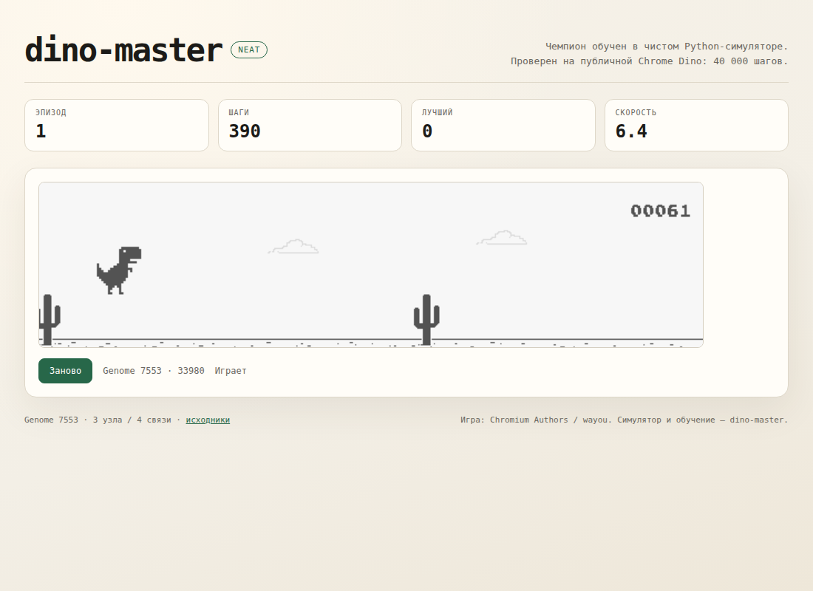

# dino-master

Агент для Chrome Dino на NEAT: обучение в **чистом Python-симуляторе**, затем проверка на реальной игре.

## Результат

Чемпион `models/champion-7553.pkl` прошёл **40 000 шагов** на публичной игре
[wayou/t-rex-runner](https://wayou.github.io/t-rex-runner/). Воспроизведение — через `dino-eval`:

| запуск | шаги | время при 60 Гц |
|---|---:|---:|
| публичный сайт, 1 | 40 000 | ~10.7 мин |
| публичный сайт, 2 | 40 000 | ~10.7 мин |
| публичный сайт, 3 | 40 000 | ~10.7 мин |
| локальная копия | 40 000 | ~10.7 мин |
| этот репозиторий (`dino-eval`) | 40 000 | ~10.7 мин |

Геном совсем небольшой: 3 узла / 4 связи.

## Демо

Живая страница: **https://btur99.github.io/dino-master/**

Она крутит копию оригинальной игры и управляет ею экспортированной сетью чемпиона.



## Быстрый старт

```bash
uv sync
uv run dino-train --generations 50 --population 500 --max-steps 30000 \
  --episodes-per-gen 4 --best models/best.pkl

# проверка на реальной игре (Google Chrome)
uv sync --extra real
uv run dino-eval --genome models/champion-7553.pkl --episodes 3 \
  --max-steps 40000 --out eval.json

# посмотреть, как играет чемпион
uv run dino-spectate --genome models/champion-7553.pkl
```

Если Chrome не найден автоматически, задайте `DINO_CHROME_EXECUTABLE`.
`DINO_HEADLESS=1` запускает проверку без видимого окна.

## Как это работает

- `src/dino_master/sim.py` — точный порт физики Dino, препятствий, зазоров и
  collision box из оригинального `index.js`.
- `src/dino_master/features.py` — 24 признака наблюдения, маска действий,
  удержание приседа, cooldown прыжка, curriculum и fitness.
- `src/dino_master/train.py` — эволюция NEAT в симуляторе: 500 геномов, 60 Гц,
  без браузера. Fitness: `шаги + 5 × препятствия + 1000` за достижение `max_steps`.
- `src/dino_master/real_game.py` — проверка через Playwright/Chrome на публичной игре.
- `src/dino_master/spectate.py` — видимое окно с текущим геномом.

Обучение использует 4 независимых эпизода на поколение и curriculum
`6 → 8 → 10 → 13` (по 5 поколений), затем естественный разгон.

## Структура

```text
src/dino_master/neat.ini  конфиг NEAT (24 → 3, pop 500)
models/                   pickle чемпиона
src/dino_master/          симулятор, признаки, обучение, eval, spectator
docs/                     GitHub Pages: игра + JS-контроллер чемпиона
scripts/export_champion.py экспорт pkl → docs/champion.json
tests/                    unit-тесты без браузера
```

## Ограничения

- Чемпион — маленькая реактивная сеть; результат проверен на публичной игре,
  но один отчёт не заменяет полный бенчмарк.
- Для реальной проверки нужны Google Chrome и доступ в сеть.
- `step_delay=0.016` соответствует 60 Гц; окно браузера должно быть активным.
- Неудачный эксперимент с бонусом за птеродактилей в репозиторий не включён.

## Благодарности

Chrome Dino — Chromium Authors; публичная версия — [wayou](https://github.com/wayou/t-rex-runner).
В этом репозитории нет копии игровых ассетов.
